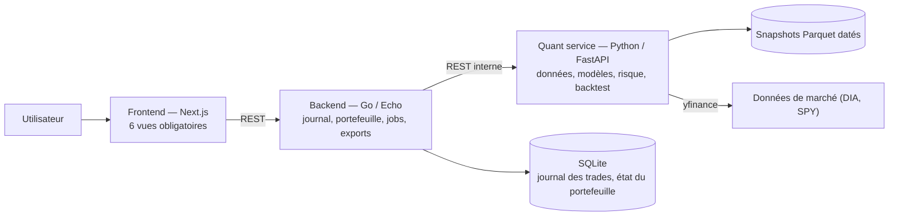
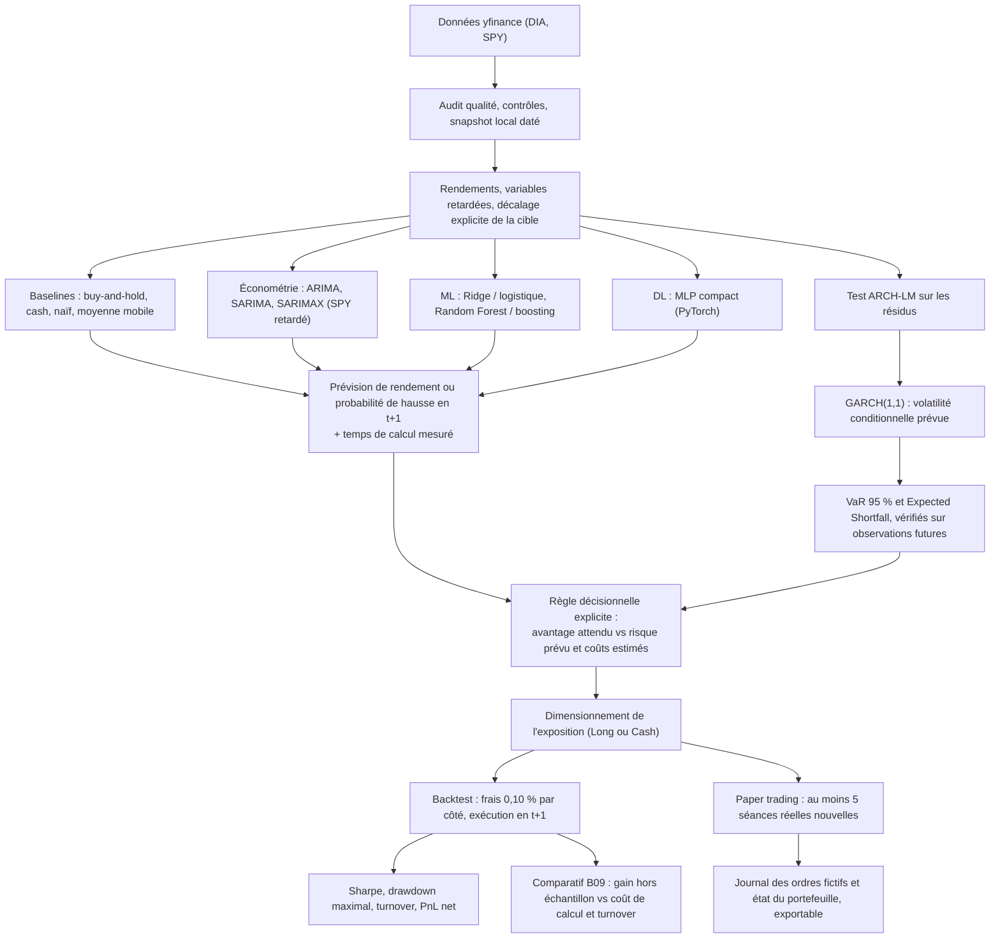

# QUANT LAB — Projet Intégrateur : Trading Intelligent

> **Projet de cours :** Trading Intelligent
> **Auteur et responsable pédagogique :** Pr. Tawfik Masrour
> **Département d'informatique — Faculté des Sciences — Université Mohammed V, Rabat**
> **Édition :** Novembre 2026
> **Variante attribuée :** **B09 · DIA — Grandes capitalisations du Dow Jones**

---

## 1. Identification du binôme et cadrage général

* **Binôme :**
  * **Étudiant 1 :** Aghazzaf Hamza
  * **Étudiant 2 :** Zakaria El Bidali
* **Rôle de l'équipe :** Équipe de recherche et d'ingénierie quantitative.
* **Mission :** Concevoir une application Web interactive, modulaire, reproductible et scientifiquement défendable, couvrant l'ensemble de la chaîne de valeur du trading quantitatif : de l'ingestion des données de marché à la simulation de trading (backtest et paper trading).

---

## 2. Périmètre des actifs financiers

* **Actif principal étudié :** `DIA` (*SPDR Dow Jones Industrial Average ETF Trust*).
  * Réplique le Dow Jones Industrial Average : trente grandes entreprises américaines établies, pondérées par le prix.
  * Actif très liquide, à dominante *large cap* et *value*, structurellement moins volatil qu'un ETF technologique — ce qui en fait un terrain favorable aux modèles parcimonieux.
* **Instrument de comparaison (benchmark commun) :** `SPY` (*SPDR S&P 500 ETF Trust*).
  * Benchmark du marché actions américain large, utilisé pour mesurer la performance relative et comme variable exogène retardée dans SARIMAX.
* **Fréquence et conventions :** données journalières ajustées (OHLCV), décision prise après la clôture de la séance `t`, exécution à l'ouverture `t+1` au plus tôt.

---

## 3. Problématique et question scientifique (spécifique B09)

* **Question de recherche :**
  > *Les modèles ML/DL justifient-ils leur complexité face à SARIMAX sur un ETF de grandes entreprises ?*

* **Hypothèse scientifique :**
  Sur un actif aussi large, liquide et suivi que le DIA, l'information exploitable dans la série des rendements est faible et largement captée par une spécification économétrique bien choisie. Nous posons donc l'hypothèse que le gain prédictif hors échantillon d'un modèle arborescent ou d'un MLP sur un SARIMAX conditionné par SPY retardé est marginal, et qu'il peut être entièrement annulé une fois confronté à son coût réel : coût de calcul et turnover supplémentaire net de frais.

* **Expérience distinctive imposée :**
  Comparer le gain hors échantillon à un **coût de calcul** et à un **turnover mesurés**. Concrètement, chaque modèle est instrumenté et consigne :
  1. son temps d'entraînement et son temps d'inférence, enregistrés par le moteur de jobs ;
  2. le turnover de la stratégie qu'il engendre, ainsi que les frais cumulés associés ;
  3. son gain de précision hors échantillon par rapport à la baseline SARIMAX, à cible, instant d'information, fenêtres et coûts strictement identiques.

* **Angle de discussion final :**
  Efficience prédictive et opérationnelle. Un modèle plus complexe peut être rejeté si sa valeur ajoutée hors échantillon est insuffisante : conclure à la supériorité de SARIMAX est un résultat scientifique légitime, et non un échec du projet.

---

## 4. Cadre opérationnel et règles méthodologiques

* **Capital initial simulé :** 100 000 USD virtuels (aucun argent réel, aucun compte de courtage réel).
* **Univers d'investissement :** Long / Cash uniquement, fraction investie comprise entre 0 % et 100 %.
* **Contraintes d'exposition :** pas de vente à découvert, pas d'effet de levier, aucun emprunt, une seule exposition principale.
* **Absence de fuite d'information (*data leakage*) :**
  * La décision pour la séance `t+1` est prise après la clôture de `t`, en n'utilisant que des informations observables à `t` au plus tard.
  * Le décalage de la cible est centralisé dans une fonction unique de `src/features.py`, couverte par un test `pytest` qui échoue si une valeur future remonte dans les variables passées.
  * Normalisations, calculs statistiques et entraînements sont étanches entre apprentissage, validation et test.
  * Aucune sélection de stratégie sur le test final ; toute adaptation en paper trading est signalée comme nouvelle version.
* **Coûts de transaction et frictions :**
  * Frais de courtage explicites : 0,05 % par transaction.
  * Glissement hypothétique (*slippage*) : 0,05 % par transaction.
  * **Coût de référence : 0,10 % par côté** (achat ou vente).
  * Scénario de sensibilité : coûts doublés (0,20 % par côté).
* **Découpage temporel des données (gelé avant tout entraînement) :**

  | Fenêtre | Période | Usage |
  | :--- | :--- | :--- |
  | Apprentissage | 2018 – 2022 | Estimation des paramètres |
  | Validation | 2023 – 2024 | Sélection de modèles et hyperparamètres |
  | Test final | 2025-01-01 → 2026-10-30 | Évaluation hors échantillon, gelée |

* **Métriques d'évaluation :** rendement et volatilité annualisés, ratio de Sharpe, drawdown maximal, turnover, frais, nombre de transactions, stabilité, perte extrême, VaR et Expected Shortfall.

---

## 5. Architecture de l'application

Nous retenons une architecture en **trois services**, afin de séparer strictement le cœur scientifique de la couche applicative. Le frontend ne communique jamais directement avec le service quantitatif.



| Service | Répertoire | Responsabilité |
| :--- | :--- | :--- |
| **Frontend** | `frontend/` | Six vues : Market Data, Model Laboratory, Risk Management, Trading Strategy, Backtesting, Paper Trading |
| **Backend** | `backend/` | API principale, journal de trading, état du portefeuille, orchestration et suivi des jobs, exports |
| **Quant service** | `quant-service/` | Collecte et snapshots, features, modèles économétriques / ML / DL, module de risque, moteur de backtest, paper trading |

### Flux scientifique interne au quant-service

Chaque bloc alimente le suivant sans jamais utiliser d'information future :



### Mode DEMO

Le quant-service embarque un **mode DEMO hors réseau** alimenté par un snapshot gelé, ainsi qu'un point d'entrée Streamlit mono-processus (`quant-service/app_demo.py`). L'application reste donc démontrable et le parcours complet reproductible même si une API externe est indisponible ou si le réseau fait défaut.

---

## 6. Structure du dépôt

```
frontend/                    # Next.js — six vues
backend/                     # Go / Echo
  cmd/server/                # point d'entrée
  internal/handlers/         # handlers HTTP
  internal/quantclient/      # client interne vers le quant-service
  internal/store/            # SQLite : jobs, journal, portefeuille
quant-service/               # Python / FastAPI
  main.py                    # point d'entrée FastAPI
  api/                       # routeurs : validation et sérialisation uniquement
  src/                       # data, features, risk, strategy, backtest, paper
  src/models/                # baselines, arima, garch, ml, dl, registry
  jobs.py                    # file de jobs + mesure du coût de calcul
  app_demo.py                # mode DEMO Streamlit
  configs/                   # paramètres gelés, splits, seeds
  data/                      # snapshots Parquet datés + README de provenance
  notebooks/                 # preuves exploratoires
  tests/                     # pytest, dont les tests anti-fuite
  reports/                   # tableaux de résultats et figures
docker-compose.yml
.env.example
```

Règle d'architecture : `src/` n'importe jamais FastAPI, et `api/` ne contient aucun calcul. Les notebooks, le mode DEMO et l'API consomment le même code.

---

## 7. Répartition explicite des responsabilités

| Domaine / Rôle | Responsable | Tâches principales |
| :--- | :--- | :--- |
| **Pôle Données, Économétrie & Risque** | **Étudiant 1** | • Collecte, audit qualité et snapshots datés de DIA et SPY.<br>• Baselines, ARIMA, SARIMA, SARIMAX avec SPY retardé.<br>• Module de risque : ARCH-LM, GARCH(1,1), volatilité prévue, VaR et Expected Shortfall.<br>• Vues *01 Market Data* et *03 Risk Management*. |
| **Pôle Machine Learning, Moteur & Simulation** | **Étudiant 2** | • Ridge / régression logistique, Random Forest / gradient boosting, MLP PyTorch.<br>• Instrumentation du coût de calcul — mesure centrale de la variante B09.<br>• Moteur de backtest (frais, slippage, drawdown, Sharpe, turnover).<br>• Paper trading et journal d'ordres exportable.<br>• Vues *02 Model Lab*, *04 Strategy*, *05 Backtesting*, *06 Paper Trading*. |
| **Responsabilités partagées** | **Binôme** | • Cadrage initial et architecture du dépôt (D01).<br>• Contrat d'API entre les trois services et assemblage de l'application (D07).<br>• Tests `pytest`, gestion des seeds et reproductibilité (D09).<br>• Rapport de recherche (12–18 pages) et soutenance finale (D10). |

---

## 8. Suivi des livrables

| Livrable | Intitulé | Emplacement dans le dépôt | État |
| :--- | :--- | :--- | :--- |
| D01 | Cadrage et dépôt | `README.md` | ✅ |
| D02 | Données et audit | `quant-service/src/data.py`, `quant-service/data/` | ⬜ |
| D03 | Économétrie de la moyenne | `quant-service/src/models/arima.py`, `notebooks/` | ⬜ |
| D04 | Module de risque | `quant-service/src/risk.py`, `quant-service/src/models/garch.py` | ⬜ |
| D05 | Machine Learning et Deep Learning | `quant-service/src/models/ml.py`, `dl.py` | ⬜ |
| D06 | Stratégie et backtest | `quant-service/src/strategy.py`, `backtest.py` | ⬜ |
| D07 | Application Web | `frontend/`, `backend/`, `quant-service/app_demo.py` | ⬜ |
| D08 | Paper trading | `quant-service/src/paper.py`, `reports/` | ⬜ |
| D09 | Reproductibilité et tests | `quant-service/tests/`, `requirements.txt`, `configs/` | ⬜ |
| D10 | Rapport et défense | `reports/` | ⬜ |

---

## 9. Installation et lancement

### Lancement complet

```bash
cp .env.example .env
docker compose up --build
```

| Service | URL |
| :--- | :--- |
| Frontend | http://localhost:3000 |
| Backend Go | http://localhost:8080 |
| Quant service (FastAPI, `/docs`) | http://localhost:8000/docs |

### Mode DEMO hors réseau

```bash
cd quant-service
python -m venv .venv && source .venv/bin/activate
pip install -r requirements.txt
DEMO_MODE=1 streamlit run app_demo.py
```

### Tests

```bash
cd quant-service && pytest -q
```

---

## 10. Sécurité et traçabilité

* Aucune clé API dans le dépôt ni dans les captures d'écran : variables d'environnement uniquement, `.env` exclu par `.gitignore`, `.env.example` fourni comme modèle.
* Provenance des données consignée dans `quant-service/data/README.md` : source, instrument, dates, fuseau, fréquence, convention d'ajustement, lacunes et date d'acquisition.
* Le téléchargement est relançable, mais la reproduction du travail repose sur une photographie locale datée et ne dépend d'aucune requête future.
* Seeds et paramètres gelés versionnés dans `quant-service/configs/`.
* Aucun argent réel, aucun compte de courtage réel, aucun versement à aucun moment.
