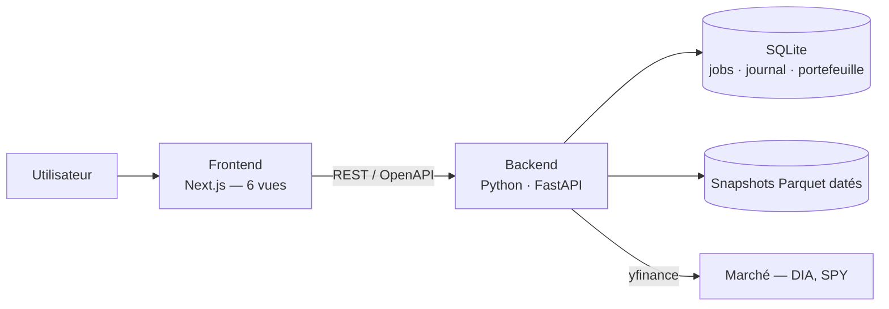

# Quant Lab · B09 — DIA

**Trading Intelligent — projet intégrateur**
Faculté des Sciences, Université Mohammed V, Rabat · Département d'informatique
Responsable pédagogique : Pr. Tawfik Masrour · Édition novembre 2026

**Binôme :** Hamza Aghazzaf · Zakaria El Bidali

---

## 1. De quoi il s'agit

Ce dépôt contient une application Web qui apprend à trader un ETF américain avec de l'argent fictif, et qui mesure honnêtement si elle y arrive.

Notre actif est le **DIA**, l'ETF qui réplique le Dow Jones Industrial Average — trente grandes entreprises américaines établies. Notre point de comparaison, imposé à tous les binômes, est le **SPY**, l'ETF du S&P 500, qui représente le marché actions américain dans son ensemble.

L'application couvre toute la chaîne : elle télécharge les données de marché, les audite, entraîne plusieurs familles de modèles, estime le risque, transforme les prévisions en décisions d'achat ou de retour en liquidités, simule ces décisions sur l'historique, puis les suit sur de nouvelles séances réelles. Six espaces, un parcours continu — chaque étape consomme la sortie de la précédente.

Le capital est de 100 000 dollars virtuels. Aucun argent réel n'intervient à aucun moment.

---

## 2. Notre question

> **Les modèles de machine learning et de deep learning justifient-ils leur complexité face à SARIMAX sur un ETF de grandes entreprises ?**

Cette question se pose avec une force particulière sur le DIA. Le Dow Jones est l'indice le plus suivi de la planète : il reste très peu d'information exploitable dans ses rendements journaliers, et ce qui en reste est probablement linéaire et de courte portée.

Notre hypothèse est donc qu'un SARIMAX bien spécifié, nourri du rendement de SPY de la veille, capte l'essentiel de ce signal. Un Random Forest ou un réseau de neurones gagneront peut-être un ou deux points de précision — mais ces points se paient deux fois : en temps de calcul, et en rotation de portefeuille, donc en frais.

Nous ne voulons pas supposer ce prix, nous voulons le chiffrer. Chaque modèle du dépôt est donc mesuré sur trois axes, et c'est leur confrontation qui tranche :

1. **Le gain de précision** hors échantillon, par rapport à la baseline SARIMAX.
2. **Le coût de calcul** — temps d'entraînement et d'inférence, enregistrés à chaque exécution.
3. **Le turnover** de la stratégie induite, et les frais qu'il engendre.

Un modèle qui prédit mieux mais coûte dix fois plus cher et fait tourner le portefeuille deux fois plus vite n'est pas un meilleur modèle.

Il faut le dire d'emblée : la conclusion peut aller contre les modèles complexes, et ce serait un résultat, non un échec. Le cahier autorise explicitement de rejeter un modèle plus complexe dont la valeur ajoutée hors échantillon est insuffisante.

**Angle de discussion final :** efficience prédictive et opérationnelle.

### Pourquoi cette variante et pourquoi le DIA

Nous avons choisi B09 pour deux raisons.

La question d'abord : savoir si la complexité se paie est une question dont nous ne connaissons pas la réponse à l'avance, et qui correspond à notre formation en génie logiciel — mesurer un coût, instrumenter un pipeline et garantir la reproductibilité est notre métier.

Le DIA ensuite, parce que c'est le terrain **le plus défavorable** aux modèles complexes, et donc le test le plus propre. Sur un ETF volatil, la non-linéarité et les ruptures de régime donneraient l'avantage aux modèles souples par construction. Ici cet avantage n'est pas donné : il faut le démontrer. Si le machine learning doit perdre, c'est sur cet actif — et s'il gagne malgré tout, le résultat n'en est que plus solide.

S'ajoute un argument pratique : l'historique du DIA est long, très liquide et peu accidenté. Une différence observée entre deux modèles vient donc des modèles, et non d'un artefact de données.

---

## 3. Les données

Nous travaillons sur des séries journalières ajustées — ouverture, haut, bas, clôture, volume — pour DIA et pour SPY. « Ajustées » signifie corrigées des dividendes et des splits, sans quoi le modèle verrait des chutes de prix qui n'en sont pas.

La source est `yfinance`, mais nous ne l'interrogeons qu'une fois : le téléchargement produit un **snapshot Parquet daté** sous `backend/data/`, et c'est ce fichier que lit tout le reste du code. Nos résultats restent ainsi recalculables à l'identique même si Yahoo modifie son API.

La provenance complète — instrument, dates, fuseau, fréquence, convention d'ajustement, lacunes constatées, date d'acquisition — est consignée dans `backend/data/README.md`.

### Les fenêtres, gelées avant le premier entraînement

| Fenêtre | Période | À quoi elle sert |
| :--- | :--- | :--- |
| Apprentissage | 2018 → 2022 | Estimer les paramètres |
| Validation | 2023 → 2024 | Choisir les modèles et les hyperparamètres |
| Test | 2025-01-01 → 2026-10-30 | Évaluer, une fois, sans y toucher |

Aucun modèle n'est sélectionné ni ajusté sur la fenêtre de test : un résultat obtenu après avoir regardé le test ne prouve rien.

### L'étanchéité temporelle

C'est le point sur lequel nous avons le plus investi, pour une raison simple : une seule fuite d'information future invalide l'ensemble du projet, quelle que soit la qualité du reste.

Le principe est que la décision pour la séance `t+1` se prend après la clôture de `t`, en n'utilisant que ce qui était observable à `t` au plus tard. Trois dispositions le garantissent :

- Le décalage de la cible est écrit **une seule fois**, dans une fonction unique de `src/features.py`. Aucun autre module ne le réimplémente, donc il n'existe pas deux versions de la règle susceptibles de divergir.
- `backend/tests/test_no_leakage.py` échoue si une valeur future remonte dans une variable passée, ou si une statistique de normalisation franchit une frontière de fenêtre.
- Les statistiques de normalisation sont estimées sur l'apprentissage seul, puis appliquées. C'est une fuite discrète et classique : normaliser sur l'ensemble des données fait entrer la moyenne du futur dans le passé.

---

## 4. Les modèles

Nous montons une échelle de complexité, en gardant toujours le niveau du dessous comme référence. Tous les modèles partagent la même cible, le même instant d'information, les mêmes fenêtres de validation, les mêmes coûts et les mêmes données de test — sans cette discipline, la comparaison qui fonde notre variante n'aurait aucun sens.

**Les références simples** donnent le niveau à battre : buy-and-hold, cash permanent, modèle naïf et moyenne historique, et un croisement de moyennes mobiles. Un modèle sophistiqué qui ne les dépasse pas ne sert à rien.

**L'économétrie de la moyenne** commence par ARIMA, puis teste SARIMA. Nous ne forcerons pas de composante saisonnière si les diagnostics ne la soutiennent pas — et s'ils ne la soutiennent pas, nous l'écrirons. Vient ensuite SARIMAX, avec le rendement de SPY retardé d'un jour comme variable explicative : c'est notre baseline de référence pour la question B09.

**L'économétrie du risque** part d'un test ARCH-LM sur les résidus, pour vérifier qu'il y a bien de l'hétéroscédasticité à modéliser. Si oui, un GARCH(1,1) fournit la volatilité conditionnelle prévue, dont nous tirons la VaR à 95 % et l'Expected Shortfall. Ces mesures sont ensuite confrontées aux réalisations observées : une VaR à 95 % dépassée 15 % du temps est une mauvaise VaR, et il faut pouvoir le constater.

**Le machine learning** apporte un modèle linéaire régularisé — Ridge ou régression logistique selon la cible — et un modèle arborescent, Random Forest ou gradient boosting.

**Le deep learning** se limite à un MLP compact entraîné sous protocole temporel. Un LSTM resterait un approfondissement facultatif ; nous préférons investir ce temps dans la mesure du coût, qui est le cœur de notre question.

Les modèles de rendement et les modèles de risque sont évalués **séparément** avant d'être intégrés à la décision : un bon prévisionniste n'est pas automatiquement un bon décideur, et il faut pouvoir distinguer les deux échecs.

---

## 5. La décision

Une prévision n'est pas une décision, et notre règle est écrite pour que le passage de l'une à l'autre soit vérifiable.

Un signal d'achat n'est émis que si l'avantage attendu dépasse le seuil prévu au protocole — seuil qui intègre la prévision de rendement, la pénalité de risque issue du GARCH, et les coûts estimés de la transaction. Si l'avantage ne couvre pas les coûts, nous ne bougeons pas.

Rester liquide est toujours une décision légitime. Une période sans aucun ordre est un résultat valide, à condition qu'elle découle réellement de la règle et non d'un défaut.

Le dimensionnement suit la volatilité prévue : la position se réduit lorsque le GARCH annonce un risque plus élevé.

| Règle | Valeur |
| :--- | :--- |
| Exposition | Long / cash, fraction investie dans [0 %, 100 %] |
| Interdits | Vente à découvert, levier, emprunt, exposition multiple |
| Calendrier | Signal après clôture `t`, exécution à l'ouverture `t+1` au plus tôt |
| Frais | 0,05 % par transaction |
| Glissement | 0,05 % par transaction |
| Coût de référence | **0,10 % par côté** — scénario de sensibilité : 0,20 % |

Un résultat qui ne survit pas au doublement des coûts n'est pas un résultat solide.

---

## 6. Les preuves

Deux niveaux, et le second est le seul qui ne puisse pas être contaminé.

**Le backtest**, sur l'historique : courbe de capital, journal des trades, frais, drawdown maximal, rendement et volatilité annualisés, Sharpe, turnover, nombre de transactions, perte extrême, VaR et Expected Shortfall. Tout en net, et toujours comparé au buy-and-hold et à la position cash.

**Le paper trading.** Nous gelons la stratégie, puis nous la suivons sur au moins cinq séances réelles nouvelles — des séances qui n'existaient pas lorsque les modèles ont été entraînés. Chaque séance produit un signal daté, un ordre fictif le cas échéant, l'état du portefeuille et la raison de la décision. Une absence d'ordre n'est pas un échec si elle est justifiée.

C'est la seule preuve à l'abri du futur, puisque le futur n'était pas encore arrivé.

---

## 7. L'application

Deux services : un backend Python qui porte tout le travail scientifique, et un frontend qui l'expose.

Le **frontend** en Next.js et TypeScript porte les six espaces obligatoires : Market Data, Model Laboratory, Risk Management, Trading Strategy, Backtesting et Paper Trading. Les graphiques sont en Plotly.js, et le client TypeScript est généré depuis le schéma OpenAPI du backend — le contrat est donc vérifié à la compilation plutôt qu'à l'exécution.

Le **backend** en Python avec FastAPI porte les données, les features, les modèles, le risque, la règle de décision, le moteur de backtest, le paper trading, le journal des ordres et l'état du portefeuille. Il n'y a qu'un seul langage côté serveur, et donc un seul endroit où chercher un bug.

### Un invariant que nous nous imposons

`src/` n'importe jamais FastAPI, et `api/` ne contient aucun calcul : un routeur valide, appelle `src/`, sérialise. La conséquence est que nos notebooks, notre API et notre mode démonstration consomment exactement le même code. Il n'existe pas trois implémentations du même modèle susceptibles de donner trois résultats — c'est ce qui rend un chiffre du rapport recalculable.

### L'entraînement asynchrone

`POST /models/train` renvoie immédiatement un identifiant de job ; l'entraînement s'exécute en tâche de fond et le frontend interroge son état. Nous l'avons conçu ainsi pour une raison technique : l'ajustement d'un GARCH ou d'un MLP dépasse le délai d'une requête HTTP synchrone.

L'effet secondaire est exactement ce dont notre variante avait besoin. Chaque enregistrement de job porte les durées d'entraînement et d'inférence : notre axe « coût de calcul » est produit par l'architecture elle-même, à chaque exécution, et non par une mesure ajoutée après coup au moment de rédiger le rapport.

### Le mode DEMO

`DEMO_MODE=1` fait lire le snapshot gelé au lieu du réseau, et `backend/app_demo.py` offre un point d'entrée Streamlit mono-processus. L'application reste donc démontrable sans réseau, et même si le frontend ne démarre pas sur la machine de l'évaluateur.

---

## 8. Qui fait quoi

**Hamza Aghazzaf — données, économétrie et risque.** Collecte, audit qualité et snapshots de DIA et SPY (D02). ARIMA, SARIMA et SARIMAX avec SPY retardé (D03). Test ARCH-LM, GARCH(1,1), volatilité prévue, VaR et Expected Shortfall (D04). Vues Market Data et Risk Management.

**Zakaria El Bidali — apprentissage, moteur et simulation.** Ridge ou régression logistique, Random Forest ou gradient boosting, MLP PyTorch (D05). Instrumentation du coût de calcul, mesure centrale de notre variante. Moteur de décision et de backtest (D06). Paper trading et journal exportable (D08). Vues Model Lab, Strategy, Backtesting et Paper Trading.

**Ensemble.** Cadrage et architecture du dépôt (D01). Contrat OpenAPI entre le backend et le frontend, et assemblage de l'application (D07). Tests, seeds et reproductibilité (D09). Rapport et soutenance (D10).

Chacun de nous doit pouvoir expliquer les modèles, le backtest et la chaîne de décision complète — y compris la partie dont il n'est pas responsable.

Les seeds et les paramètres gelés sont versionnés dans `backend/configs/frozen.yaml`. Les graphiques sont titrés, les unités indiquées, les prévisions confrontées à leurs réalisations. Quand une approche échoue, nous l'expliquons plutôt que de la retirer du rapport : un échec compris vaut mieux qu'un résultat flatteur inexpliqué.

Aucun argent réel n'intervient à aucune étape du projet, et aucun compte de courtage réel n'est ouvert.
