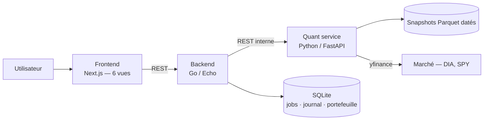
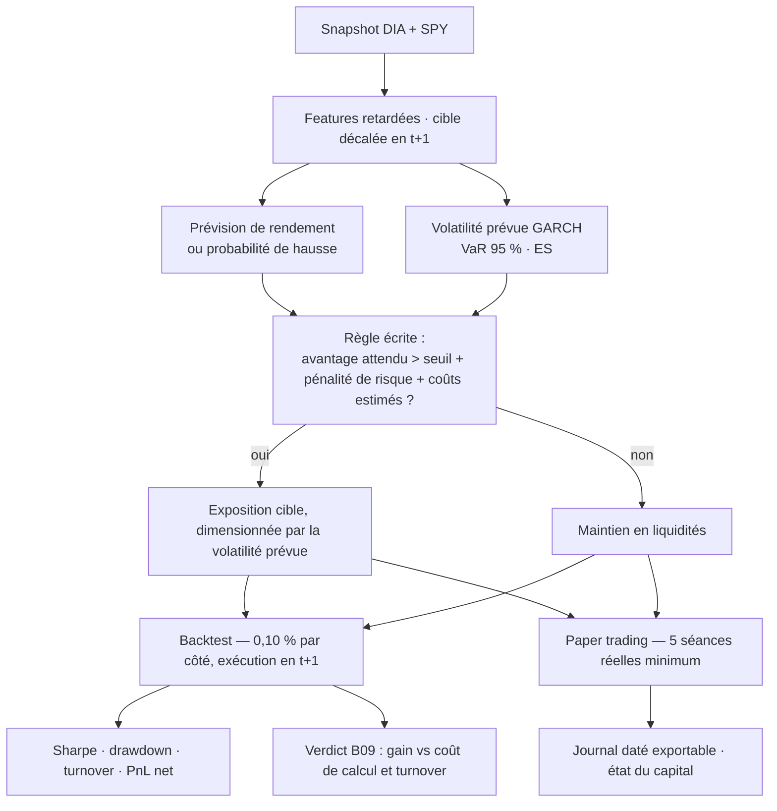

# Quant Lab · B09 — DIA

**Trading Intelligent — projet intégrateur**
Faculté des Sciences, Université Mohammed V, Rabat · Département d'informatique
Responsable pédagogique : Pr. Tawfik Masrour · Édition novembre 2026

| | |
| :--- | :--- |
| **Variante** | B09 — Grandes capitalisations du Dow Jones |
| **Actif** | `DIA` · benchmark `SPY` |
| **Binôme** | Hamza Aghazzaf · Zakaria El Bidali |
| **Dépôt** | Trois services : Next.js, Go/Echo, Python/FastAPI |

---

## Ce que nous cherchons à savoir

> **Les modèles ML/DL justifient-ils leur complexité face à SARIMAX sur un ETF de grandes entreprises ?**

Le DIA réplique le Dow Jones Industrial Average : trente sociétés américaines matures, pondérées par le prix, dans l'un des indices les plus observés au monde. Le signal exploitable dans ses rendements journaliers y est donc faible, et nous faisons l'hypothèse qu'un SARIMAX conditionné par SPY retardé en capte l'essentiel. Un Random Forest ou un MLP peuvent gagner quelques points de précision — mais ce gain se paie, en temps de calcul et en rotation de portefeuille.

Notre travail consiste à **chiffrer ce prix** plutôt qu'à le supposer. Chaque modèle du dépôt est instrumenté sur trois axes :

| Axe mesuré | Où il est produit | Ce qu'il sert à décider |
| :--- | :--- | :--- |
| Gain hors échantillon vs SARIMAX | `src/models/registry.py` | Le modèle prédit-il réellement mieux ? |
| Temps d'entraînement et d'inférence | `jobs.py`, par exécution | À quel coût opérationnel ? |
| Turnover et frais cumulés induits | `src/backtest.py` | Le gain survit-il aux frictions ? |

Conclusion attendue, quelle qu'elle soit : le cahier autorise explicitement le rejet d'un modèle complexe dont la valeur ajoutée hors échantillon est insuffisante. Si SARIMAX l'emporte sur les trois axes, c'est notre résultat — et il est publiable tel quel.

**Discussion finale :** efficience prédictive et opérationnelle.

---

## Protocole

### Données

Séries journalières ajustées (OHLCV) pour DIA et pour SPY, synchronisées. Source `yfinance`, figée en snapshots Parquet datés sous `quant-service/data/`. Le téléchargement reste relançable, mais aucune reproduction du travail ne dépend d'une requête future : tout le code lit le snapshot.

La provenance complète — instrument, dates, fuseau, fréquence, convention d'ajustement, lacunes, date d'acquisition — est tenue dans `quant-service/data/README.md`.

### Fenêtres, gelées avant le premier entraînement

```
apprentissage   2018-01-01 → 2022-12-31     estimation des paramètres
validation      2023-01-01 → 2024-12-31     sélection de modèles, hyperparamètres
test            2025-01-01 → 2026-10-30     évaluation finale, intouchable
```

Aucun modèle n'est choisi ni ajusté sur la fenêtre de test. Toute modification postérieure au gel de la stratégie est versionnée comme une nouvelle version et signalée dans le journal.

### Étanchéité temporelle

C'est le point sur lequel nous avons le plus investi en ingénierie, parce qu'une fuite invalide tout le reste.

- Le signal de la séance `t+1` se décide après la clôture de `t`, sur la seule information disponible à `t`.
- Le décalage de la cible est écrit **une seule fois**, dans une fonction unique de `src/features.py`. Aucun module ne le réimplémente.
- `quant-service/tests/test_no_leakage.py` échoue si une valeur future remonte dans une variable passée, ou si une normalisation franchit une frontière de fenêtre.
- Les statistiques de normalisation sont estimées sur l'apprentissage seul, puis appliquées.

### Règles de marché

```
capital initial      100 000 USD virtuels — aucun argent réel, aucun compte réel
exposition           long/cash, fraction investie dans [0 %, 100 %]
interdits            vente à découvert, levier, emprunt, exposition multiple
exécution            ouverture de t+1 au plus tôt
frais                0,05 %  par transaction
glissement           0,05 %  par transaction
coût de référence    0,10 %  par côté — scénario de stress : 0,20 %
```

Rester liquide est toujours une décision légitime. Une stratégie sans transaction est un résultat valide si elle découle réellement de la règle fixée.

### Mesures rapportées

Rendement et volatilité annualisés, Sharpe, drawdown maximal, turnover, frais, nombre de transactions, perte extrême, VaR 95 %, Expected Shortfall — toujours nets, toujours comparés au buy-and-hold et à la position cash.

---

## Modèles comparés

Tous partagent la même cible, le même instant d'information, les mêmes fenêtres de validation, les mêmes coûts et les mêmes données de test. Sans cela, la comparaison B09 ne veut rien dire.

| Famille | Ce que nous construisons | Module |
| :--- | :--- | :--- |
| Références | Buy-and-hold, cash permanent, naïf / moyenne historique, croisement de moyennes mobiles | `models/baselines.py` |
| Moyenne conditionnelle | ARIMA, puis SARIMA si les diagnostics soutiennent une saisonnalité, puis SARIMAX avec SPY retardé | `models/arima.py` |
| Risque | ARCH-LM sur résidus, GARCH(1,1), volatilité prévue, VaR et ES vérifiées sur réalisations futures | `models/garch.py`, `src/risk.py` |
| Machine Learning | Ridge ou régression logistique selon la cible ; Random Forest ou gradient boosting | `models/ml.py` |
| Deep Learning | MLP compact sous protocole temporel (PyTorch) | `models/dl.py` |

La saisonnalité n'est pas imposée : si les diagnostics ne la soutiennent pas, SARIMA est écarté et nous le disons. Les modèles de rendement et de risque sont évalués séparément avant d'être intégrés à la décision.

---

## Architecture

Trois services séparés. Le frontend ne connaît que le backend Go ; le cœur scientifique reste isolé derrière une API interne.



| Service | Ce qu'il possède |
| :--- | :--- |
| `frontend/` | Les six espaces : Market Data, Model Laboratory, Risk Management, Trading Strategy, Backtesting, Paper Trading |
| `backend/` | Utilisateurs, journal des ordres, état du portefeuille, orchestration et suivi des jobs, exports |
| `quant-service/` | Données, features, modèles, risque, règle de décision, moteur de backtest, paper trading |

**Invariant du dépôt :** `src/` n'importe jamais FastAPI, et `api/` ne contient aucun calcul. Un routeur valide, appelle `src/`, sérialise. Les notebooks, l'API et le mode DEMO consomment donc exactement le même code — c'est ce qui rend les résultats recalculables.

**Entraînement asynchrone.** `POST /models/train` renvoie immédiatement un identifiant de job ; l'entraînement s'exécute en tâche de fond et le frontend interroge son état. Un ajustement GARCH ou MLP dépasserait le délai d'une requête HTTP synchrone. Effet secondaire utile : l'enregistrement du job porte les durées, donc l'axe « coût de calcul » de B09 est produit par l'architecture elle-même, pas par une mesure ajoutée après coup.

**Mode DEMO.** `DEMO_MODE=1` fait lire le snapshot gelé au lieu du réseau, et `quant-service/app_demo.py` offre un point d'entrée Streamlit mono-processus. Le parcours complet reste donc démontrable même sans réseau, et même si le backend Go ou le frontend ne démarrent pas sur la machine de l'évaluateur.

---

## Chaîne de décision



Un signal « acheter » n'est émis que si l'avantage attendu dépasse le seuil prévu au protocole, pénalité de risque et coûts estimés déduits. Les règles de dimensionnement sont écrites et vérifiées ; elles peuvent réduire la position après une hausse de volatilité prévue.

---

## Organisation du dépôt

```
frontend/                  Next.js — six vues, un seul client API (lib/api.ts)
backend/
  cmd/server/              point d'entrée Echo
  internal/handlers/       handlers HTTP
  internal/quantclient/    client interne vers le quant-service
  internal/store/          SQLite : jobs, journal, portefeuille
quant-service/
  main.py                  FastAPI — montage des routeurs
  api/                     validation et sérialisation, aucun calcul
  src/                     data · features · risk · strategy · backtest · paper
  src/models/              baselines · arima · garch · ml · dl · registry
  jobs.py                  file de jobs, mesure du coût de calcul
  app_demo.py              mode DEMO Streamlit
  configs/frozen.yaml      splits, coûts, seed, capital — gelés
  data/                    snapshots datés + provenance
  notebooks/               preuves exploratoires
  tests/                   pytest, dont l'étanchéité temporelle
  reports/                 tableaux de résultats et figures
docker-compose.yml  .env.example  .gitignore
```

---

## Qui fait quoi

| | [Nom 1] | [Nom 2] | Ensemble |
| :--- | :---: | :---: | :---: |
| Collecte, audit qualité, snapshots (D02) | ● | | |
| ARIMA · SARIMA · SARIMAX (D03) | ● | | |
| ARCH-LM · GARCH · VaR · ES (D04) | ● | | |
| Vues Market Data et Risk Management | ● | | |
| Ridge / logistique · arbres / boosting · MLP (D05) | | ● | |
| Instrumentation du coût de calcul (axe B09) | | ● | |
| Moteur de backtest et de décision (D06) | | ● | |
| Paper trading et journal exportable (D08) | | ● | |
| Vues Model Lab, Strategy, Backtest, Paper | | ● | |
| Cadrage et architecture (D01) | | | ● |
| Contrat d'API entre les trois services (D07) | | | ● |
| Tests, seeds, reproductibilité (D09) | | | ● |
| Rapport et soutenance (D10) | | | ● |

Chacun doit pouvoir expliquer les modèles, le backtest et la chaîne de décision complète, y compris la partie dont il n'est pas responsable.

---

## Où trouver chaque livrable

| | Livrable | Emplacement | État |
| :--- | :--- | :--- | :--- |
| D01 | Cadrage et dépôt | ce fichier | ✅ |
| D02 | Données et audit | `quant-service/src/data.py` · `data/` | ⬜ |
| D03 | Économétrie de la moyenne | `src/models/arima.py` · `notebooks/` | ⬜ |
| D04 | Module de risque | `src/risk.py` · `src/models/garch.py` | ⬜ |
| D05 | ML et Deep Learning | `src/models/ml.py` · `dl.py` | ⬜ |
| D06 | Stratégie et backtest | `src/strategy.py` · `src/backtest.py` | ⬜ |
| D07 | Application Web | `frontend/` · `backend/` · `app_demo.py` | ⬜ |
| D08 | Paper trading | `src/paper.py` · `reports/` | ⬜ |
| D09 | Reproductibilité et tests | `tests/` · `requirements.txt` · `configs/` | ⬜ |
| D10 | Rapport et défense | `reports/` | ⬜ |

---

## Lancer le projet

```bash
cp .env.example .env
docker compose up --build
```

| | |
| :--- | :--- |
| Frontend | http://localhost:3000 |
| Backend Go | http://localhost:8080 |
| Quant service — OpenAPI | http://localhost:8000/docs |

Sans Docker, ou pour la démonstration hors réseau :

```bash
cd quant-service
python -m venv .venv && source .venv/bin/activate
pip install -r requirements.txt
DEMO_MODE=1 streamlit run app_demo.py
```

Tests :

```bash
cd quant-service && pytest -q
```

---

## Secrets et traçabilité

Aucune clé d'API dans le dépôt ni dans les captures d'écran : variables d'environnement uniquement, `.env` exclu par `.gitignore`, `.env.example` versionné comme modèle. Seeds et paramètres gelés dans `configs/frozen.yaml`. Graphiques titrés, unités indiquées, prévisions confrontées à leurs réalisations, échecs expliqués plutôt que masqués.

Aucun argent réel n'intervient à aucune étape du projet.
