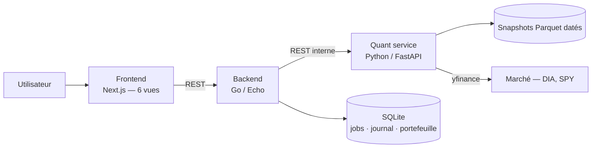
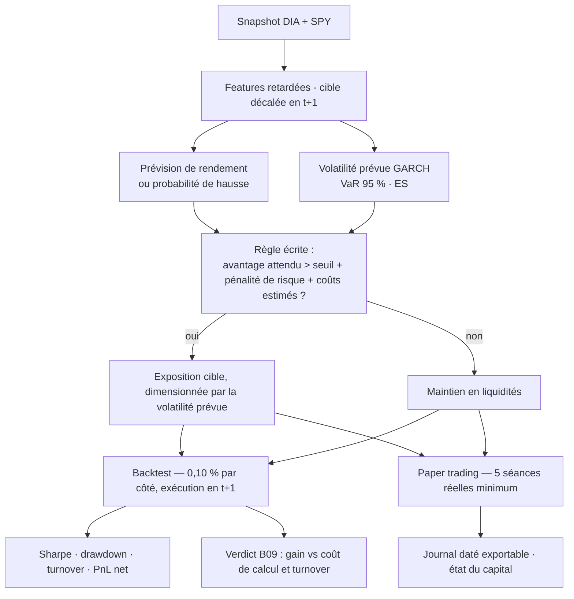

# Quant Lab · B09 — DIA

**Trading Intelligent — projet intégrateur**
Faculté des Sciences, Université Mohammed V, Rabat · Département d'informatique
Responsable pédagogique : Pr. Tawfik Masrour · Édition novembre 2026

**Binôme :** Hamza Aghazzaf · Zakaria El Bidali

---

## De quoi il s'agit

Ce dépôt contient une application Web qui apprend à trader un ETF américain avec de l'argent fictif, et qui mesure honnêtement si elle y arrive.

Notre actif est le **DIA**, l'ETF qui réplique le Dow Jones Industrial Average — trente grandes entreprises américaines établies. Notre point de comparaison est le **SPY**, l'ETF du S&P 500, qui représente le marché actions américain dans son ensemble.

L'application couvre toute la chaîne : elle télécharge les données de marché, les audite, entraîne plusieurs familles de modèles de prévision, estime le risque, transforme ces prévisions en décisions d'achat ou de retour en liquidités, simule ces décisions sur l'historique, puis les suit en direct sur de nouvelles séances. Six espaces, un parcours continu : chaque étape consomme la sortie de la précédente.

Le capital est de 100 000 dollars virtuels. Aucun argent réel n'intervient à aucun moment.

---

## La question qu'on s'est posée

> **Les modèles de machine learning et de deep learning justifient-ils leur complexité face à SARIMAX sur un ETF de grandes entreprises ?**

C'est la question imposée par notre variante, et elle se pose avec une force particulière sur le DIA.

Le Dow Jones, ce sont trente sociétés matures dans l'indice le plus scruté de la planète. Des milliers d'analystes le suivent en permanence. Autrement dit, il reste très peu d'information exploitable dans la série de ses rendements journaliers — et ce qui en reste est probablement linéaire et de courte portée.

Notre hypothèse est donc qu'un SARIMAX bien spécifié, nourri du rendement de SPY de la veille, capte l'essentiel de ce signal. Un Random Forest ou un réseau de neurones gagneront peut-être un ou deux points de précision. Mais ces points se paient deux fois : en temps de calcul, et en rotation de portefeuille — donc en frais.

La tentation serait de supposer ce prix. Nous le chiffrons. Chaque modèle du dépôt est instrumenté sur trois axes, et c'est la confrontation des trois qui tranche :

1. **Le gain de précision** hors échantillon, par rapport à la baseline SARIMAX.
2. **Le coût de calcul** — temps d'entraînement et temps d'inférence, enregistrés à chaque exécution.
3. **Le turnover** de la stratégie induite, et les frais qu'il engendre.

Un modèle qui prédit mieux mais coûte dix fois plus cher et fait tourner le portefeuille deux fois plus vite n'est pas un meilleur modèle. C'est ce que nous voulons démontrer, chiffres en main.

Il faut dire tout de suite que la conclusion peut aller contre les modèles complexes, et que ce serait un résultat et non un échec. Le cahier l'autorise explicitement : un modèle plus complexe peut être rejeté si sa valeur ajoutée hors échantillon est insuffisante. Si SARIMAX l'emporte sur les trois axes, nous le dirons et nous le défendrons.

**Angle de discussion final :** efficience prédictive et opérationnelle.

---

## Comment on travaille les données

Les données sont journalières et ajustées : pour chaque jour de bourse, l'ouverture, le plus haut, le plus bas, la clôture et le volume, pour DIA et pour SPY. « Ajustées » veut dire corrigées des dividendes et des splits — sans quoi le modèle verrait des chutes de prix qui n'en sont pas.

La source est `yfinance`. Mais nous ne l'interrogeons qu'une fois : le téléchargement produit un **snapshot Parquet daté** sous `quant-service/data/`, et c'est ce fichier que lit tout le reste du code. Le téléchargement reste relançable, mais aucun de nos résultats ne dépend d'une requête future. Si Yahoo modifie son API demain, nos chiffres restent recalculables à l'identique.

La provenance complète — instrument, dates, fuseau, fréquence, convention d'ajustement, lacunes constatées, date d'acquisition — est consignée dans `quant-service/data/README.md`.

### Les trois fenêtres

Elles sont gelées avant le premier entraînement, et nous n'y revenons pas.

| Fenêtre | Période | À quoi elle sert |
| :--- | :--- | :--- |
| Apprentissage | 2018 → 2022 | Estimer les paramètres |
| Validation | 2023 → 2024 | Choisir les modèles et les hyperparamètres |
| Test | 2025-01-01 → 2026-10-30 | Évaluer, une fois, sans y toucher |

Aucun modèle n'est sélectionné ni ajusté sur la fenêtre de test. C'est la règle qui donne un sens à tout ce qui précède : un résultat obtenu après avoir regardé le test ne prouve rien.

### L'étanchéité temporelle

C'est le point sur lequel nous avons le plus investi en ingénierie, pour une raison simple : une seule fuite d'information future invalide l'ensemble du projet, quelle que soit la qualité du reste.

Le principe est que la décision pour la séance `t+1` se prend après la clôture de `t`, en n'utilisant que ce qui était observable à `t` au plus tard. Pour le garantir plutôt que l'espérer, nous avons pris trois dispositions concrètes.

Le décalage de la cible est écrit **une seule fois**, dans une fonction unique de `src/features.py`. Aucun autre module ne le réimplémente, donc il n'existe pas deux versions de la règle susceptibles de divergir.

Un test automatique, `quant-service/tests/test_no_leakage.py`, échoue si une valeur future remonte dans une variable passée, ou si une statistique de normalisation franchit une frontière de fenêtre. Si nous cassons quelque chose, nous l'apprenons immédiatement et non à la soutenance.

Les statistiques de normalisation sont estimées sur l'apprentissage seul, puis appliquées aux autres fenêtres. C'est une fuite classique et discrète : normaliser sur l'ensemble des données fait entrer la moyenne du futur dans le passé.

---

## Les règles de marché

Nous travaillons **long ou cash** : acheter l'ETF, ou revenir en liquidités. Pas de vente à découvert, pas de levier, aucun emprunt, une seule exposition principale. La fraction investie va de 0 % à 100 %.

Les décisions se prennent après la clôture, et l'exécution a lieu à l'ouverture suivante au plus tôt.

Côté frictions, nous retenons 0,05 % de frais et 0,05 % de glissement, soit **0,10 % par côté** — à l'achat comme à la vente. Nous ajoutons systématiquement un scénario à coûts doublés, pour vérifier qu'un résultat ne tient pas uniquement à une hypothèse de frais optimiste.

Rester liquide est toujours une décision légitime. Une stratégie qui ne passe aucun ordre sur une période donnée est un résultat valide, à condition qu'elle découle réellement de la règle écrite et non d'un bug.

Nous rapportons, toujours nets et toujours comparés au buy-and-hold et à la position cash : rendement et volatilité annualisés, ratio de Sharpe, drawdown maximal, turnover, frais, nombre de transactions, perte extrême, VaR à 95 % et Expected Shortfall.

---

## Les modèles

Tous partagent la même cible, le même instant d'information, les mêmes fenêtres de validation, les mêmes coûts et les mêmes données de test. Sans cette discipline, la comparaison qui fonde notre variante n'aurait aucun sens.

**Les références simples** nous donnent le niveau à battre : buy-and-hold, cash permanent, modèle naïf et moyenne historique, et un croisement de moyennes mobiles comme règle transparente. Un modèle sophistiqué qui ne les dépasse pas ne sert à rien.

**L'économétrie de la moyenne** commence par ARIMA, puis teste SARIMA. Nous ne forcerons pas de composante saisonnière si les diagnostics ne la soutiennent pas — et s'ils ne la soutiennent pas, nous l'écrirons. Vient ensuite SARIMAX, avec le rendement de SPY retardé d'un jour comme variable explicative. C'est notre baseline de référence pour la question B09.

**L'économétrie du risque** part d'un test ARCH-LM sur les résidus, pour vérifier qu'il y a bien de l'hétéroscédasticité à modéliser. Si oui, un GARCH(1,1) fournit la volatilité conditionnelle prévue, dont nous tirons la VaR et l'Expected Shortfall. Ces mesures de risque sont ensuite confrontées aux réalisations observées : une VaR à 95 % qui est dépassée 15 % du temps est une mauvaise VaR, et il faut pouvoir le constater.

**Le machine learning** apporte un modèle linéaire régularisé — Ridge ou régression logistique selon la cible — et un modèle arborescent, Random Forest ou gradient boosting.

**Le deep learning** se limite à un MLP compact entraîné sous protocole temporel. Un LSTM resterait un approfondissement facultatif ; nous préférons investir le temps dans la mesure du coût, qui est le cœur de notre question.

Les modèles de rendement et les modèles de risque sont évalués **séparément** avant d'être intégrés à la décision. Un bon prévisionniste n'est pas automatiquement un bon décideur, et il faut pouvoir distinguer les deux échecs.

---

## L'architecture

Nous avons séparé le projet en trois services, afin que le cœur scientifique reste isolé de la couche applicative.



Le **frontend** en Next.js porte les six espaces obligatoires : Market Data, Model Laboratory, Risk Management, Trading Strategy, Backtesting et Paper Trading. Il ne parle qu'au backend Go.

Le **backend** en Go avec Echo gère ce qui relève de l'application : le journal des ordres, l'état du portefeuille, l'orchestration et le suivi des jobs, les exports.

Le **quant-service** en Python avec FastAPI porte tout le reste — les données, les features, les modèles, le risque, la règle de décision, le moteur de backtest et le paper trading.

### Un invariant qu'on s'impose

`src/` n'importe jamais FastAPI, et `api/` ne contient aucun calcul. Un routeur valide la requête, appelle `src/`, sérialise la réponse. Rien de plus.

La conséquence est importante : nos notebooks, notre API et notre mode démonstration consomment exactement le même code. Il n'existe pas trois implémentations du même modèle susceptibles de donner trois résultats. C'est ce qui rend un chiffre du rapport recalculable.

### L'entraînement asynchrone, et ce qu'il nous donne gratuitement

`POST /models/train` renvoie immédiatement un identifiant de job ; l'entraînement s'exécute en tâche de fond et le frontend interroge son état. Nous avons conçu cela pour une raison purement technique : l'ajustement d'un GARCH ou d'un MLP dépasse le délai d'une requête HTTP synchrone.

L'effet secondaire s'est révélé être exactement ce dont notre variante avait besoin. Chaque enregistrement de job porte les durées d'entraînement et d'inférence. Notre axe « coût de calcul » est donc produit par l'architecture elle-même, à chaque exécution, et non par une mesure bricolée après coup au moment de rédiger le rapport.

### Le mode DEMO

`DEMO_MODE=1` fait lire le snapshot gelé au lieu du réseau. Par ailleurs, `quant-service/app_demo.py` offre un point d'entrée Streamlit mono-processus.

L'application reste donc démontrable sans réseau, et même si le frontend ou le backend Go ne démarrent pas sur la machine de l'évaluateur. Le parcours complet est reproductible dans un seul processus Python.

---

## La chaîne de décision



Il n'y a aucune magie dans cette chaîne, et c'est volontaire. Un signal d'achat n'est émis que si l'avantage attendu dépasse le seuil fixé au protocole, pénalité de risque et coûts estimés déduits. Les règles de dimensionnement sont écrites et vérifiées ; elles peuvent réduire la position lorsque la volatilité prévue augmente.

Chaque séance produit un signal daté, un ordre fictif le cas échéant, l'état du portefeuille et la raison de la décision.

---

## Organisation du dépôt

```
frontend/                  Next.js — six vues, un seul client API (lib/api.ts)
backend/
  cmd/server/              point d'entrée Echo
  internal/handlers/       handlers HTTP
  internal/quantclient/    client interne vers le quant-service
  internal/store/          SQLite : jobs, journal, portefeuille
quant-service/
  main.py                  FastAPI — montage des routeurs
  api/                     validation et sérialisation, aucun calcul
  src/                     data · features · risk · strategy · backtest · paper
  src/models/              baselines · arima · garch · ml · dl · registry
  jobs.py                  file de jobs, mesure du coût de calcul
  app_demo.py              mode DEMO Streamlit
  configs/frozen.yaml      splits, coûts, seed, capital — gelés
  data/                    snapshots datés + provenance
  notebooks/               preuves exploratoires
  tests/                   pytest, dont l'étanchéité temporelle
  reports/                 tableaux de résultats et figures
docker-compose.yml  .env.example  .gitignore
```

---

## Qui fait quoi

Nous avons réparti le travail en deux pôles, en gardant le cadrage et l'assemblage en commun.

**[Nom 1] — données, économétrie et risque.** Collecte, audit qualité et snapshots de DIA et SPY (D02). ARIMA, SARIMA et SARIMAX avec SPY retardé (D03). Test ARCH-LM, GARCH(1,1), volatilité prévue, VaR et Expected Shortfall (D04). Vues Market Data et Risk Management.

**[Nom 2] — apprentissage, moteur et simulation.** Ridge ou régression logistique, Random Forest ou gradient boosting, MLP PyTorch (D05). Instrumentation du coût de calcul, qui est la mesure centrale de notre variante. Moteur de décision et de backtest (D06). Paper trading et journal exportable (D08). Vues Model Lab, Strategy, Backtesting et Paper Trading.

**Ensemble.** Cadrage et architecture du dépôt (D01). Contrat d'API entre les trois services et assemblage de l'application (D07). Tests, seeds et reproductibilité (D09). Rapport et soutenance (D10).

Chacun de nous doit pouvoir expliquer les modèles, le backtest et la chaîne de décision complète — y compris la partie dont il n'est pas responsable.

---

## Où trouver chaque livrable

| | Livrable | Emplacement | État |
| :--- | :--- | :--- | :--- |
| D01 | Cadrage et dépôt | ce fichier | ✅ |
| D02 | Données et audit | `quant-service/src/data.py` · `data/` | ⬜ |
| D03 | Économétrie de la moyenne | `src/models/arima.py` · `notebooks/` | ⬜ |
| D04 | Module de risque | `src/risk.py` · `src/models/garch.py` | ⬜ |
| D05 | ML et Deep Learning | `src/models/ml.py` · `dl.py` | ⬜ |
| D06 | Stratégie et backtest | `src/strategy.py` · `src/backtest.py` | ⬜ |
| D07 | Application Web | `frontend/` · `backend/` · `app_demo.py` | ⬜ |
| D08 | Paper trading | `src/paper.py` · `reports/` | ⬜ |
| D09 | Reproductibilité et tests | `tests/` · `requirements.txt` · `configs/` | ⬜ |
| D10 | Rapport et défense | `reports/` | ⬜ |

---

## Lancer le projet

```bash
cp .env.example .env
docker compose up --build
```

| | |
| :--- | :--- |
| Frontend | http://localhost:3000 |
| Backend Go | http://localhost:8080 |
| Quant service — OpenAPI | http://localhost:8000/docs |

Sans Docker, ou pour la démonstration hors réseau :

```bash
cd quant-service
python -m venv .venv && source .venv/bin/activate
pip install -r requirements.txt
DEMO_MODE=1 streamlit run app_demo.py
```

Lancer les tests :

```bash
cd quant-service && pytest -q
```

---

## Secrets et traçabilité

Aucune clé d'API ne figure dans le dépôt ni dans les captures d'écran : variables d'environnement uniquement, `.env` exclu par `.gitignore`, `.env.example` versionné comme modèle.

Les seeds et les paramètres gelés sont versionnés dans `configs/frozen.yaml`. Les graphiques sont titrés, les unités indiquées, les prévisions confrontées à leurs réalisations. Quand une approche échoue, nous l'expliquons plutôt que de la retirer du rapport — un échec compris vaut mieux qu'un résultat flatteur inexpliqué.

Aucun argent réel n'intervient à aucune étape du projet, et aucun compte de courtage réel n'est ouvert.
